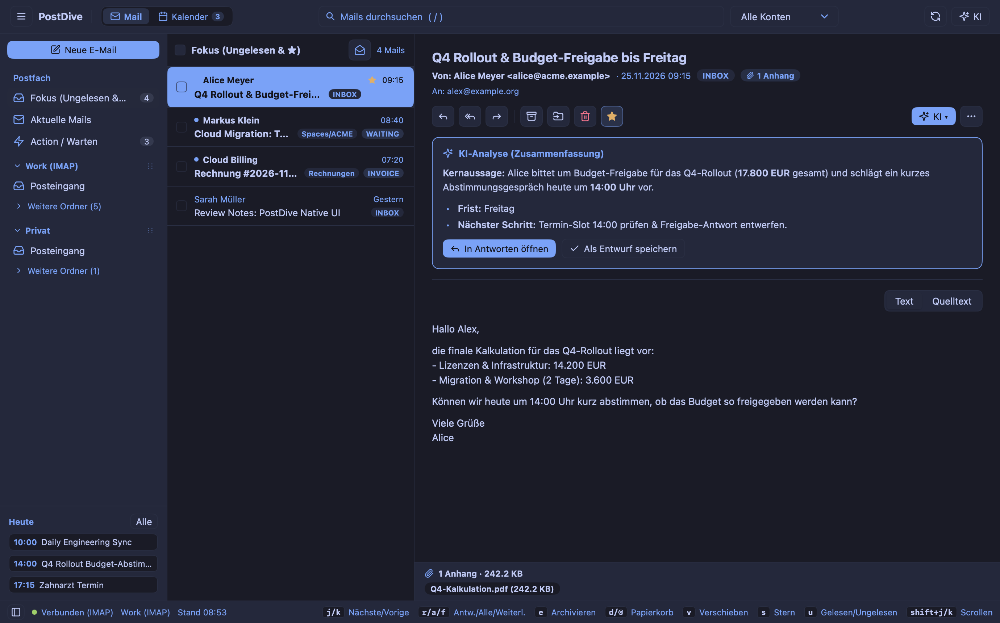
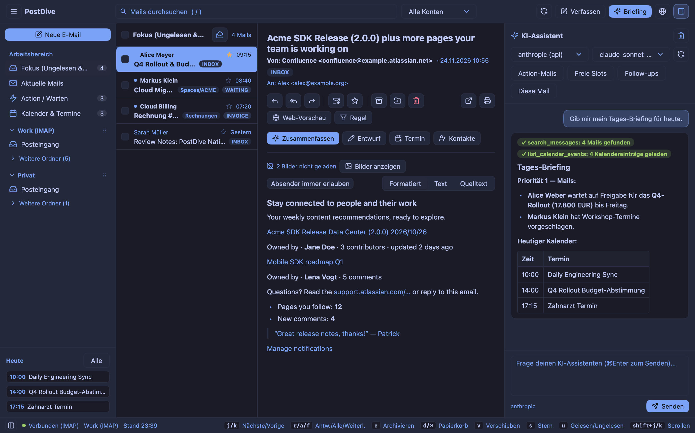
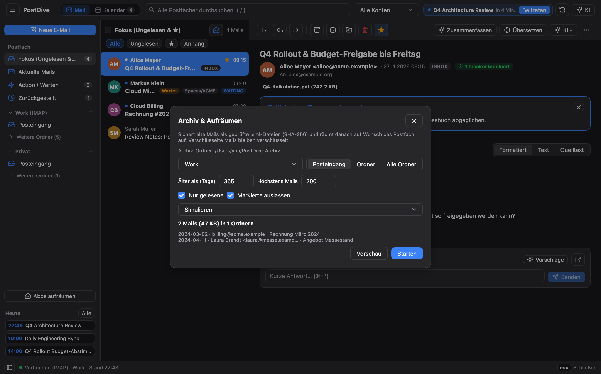

# OmaThunder

**A keyboard-driven mail app with an AI copilot on top of Thunderbird, plus Omarchy themes for Thunderbird itself – on Omarchy Linux and macOS.**



OmaThunder has three parts:

| Part | What it does |
|---|---|
| **OmaThunder app** (`omathunder ui`, on macOS `OmaThunder.app`) | Mail list and reading pane, compose, calendar, contacts, quick rules, an AI copilot, triage and archive – all through Thunderbird, so the app never needs your passwords, IMAP, SMTP, OAuth2 or CalDAV. |
| **Helper program** (`omathunder`) | Started by Thunderbird. Serves the app through a local, token-protected bridge and runs the automatic work (triage scans, archive & cleanup) – also while the app is closed. |
| **Thunderbird add-on** | The bridge into Thunderbird's data – every call checked against one policy table – and the Omarchy theme for Thunderbird's own windows. Its settings decide what OmaThunder may do at all. |

Nothing is sent or deleted automatically, and changes to mails, folders or filters are blocked by default (read-only).

> **Status:** early version (0.3). The helper, the app and the add-on's core logic are covered by unit tests; running inside Thunderbird has seen little real-world use so far. Windows builds are produced but untested.

---

## Installation

Requires Thunderbird 128 or newer.

### Homebrew (macOS, Linux)

```bash
brew install diver80/tap/omathunder
omathunder setup        # registers the helper program with Thunderbird (once)
```

Homebrew builds the helper and the app from source. Then:

1. In Thunderbird: **Add-ons and Themes → gear icon → Install Add-on From File** and pick `$(brew --prefix)/opt/omathunder/share/omathunder/omathunder-extension.xpi` (`omathunder setup` prints the exact path).
2. Restart Thunderbird, open the add-on's settings (toolbar button *OmaThunder*), switch on **Local bridge for the OmaThunder app** and enable the accounts OmaThunder may change.
3. Start the app: `omathunder ui`. On macOS you can also put it into *Applications*: `ln -sf "$(brew --prefix)/opt/omathunder/OmaThunder.app" ~/Applications/`.

After `brew upgrade omathunder`, install the `.xpi` again so add-on and helper match – the add-on's settings page warns when they don't.

### From source

```bash
git clone https://github.com/diver80/omathunder.git && cd omathunder
./build.sh        # tests, binaries, dist/omathunder-extension.xpi, OmaThunder.app (macOS)
./install.sh      # helper to ~/.local/bin, app to ~/Applications, registration with Thunderbird
```

Then install `dist/omathunder-extension.xpi` in Thunderbird as described above.

`setup` and `install.sh` only create the native messaging registration and a small launcher script. They never touch Thunderbird's profile or `prefs.js`.

---

## The app

* **Mail:** folder tree per account, two-line list, reading pane, archive and *move to…*, star, read/unread, trash, compose and reply. Opened mails are marked as read like in Thunderbird – at once, after 3 seconds or never (☰ → Settings).
* **Keyboard:** `j`/`k` next/previous mail, `x` check, `e` archive, `d` trash, `v` move to…, `s` star, `u` read/unread, `r` reply, `esc` back, `/` search, `c` compose, `h` help, `⌘,` settings. The footer always lists the keys that apply right now. Single keys never fire while you type in a field; `d` on several checked mails needs a second press.
* **Reading pane:** HTML mails are shown formatted (headings, lists, quotes, links by their title) without loading anything from the internet – no tracking pixels, no remote images; a *Formatted / Text* switch shows the text version.



* **Encrypted and signed mails:** the mail you open is decrypted by Thunderbird and marked as encrypted; AI actions you start on it send its decrypted text to your AI provider, and the pane says so. If Thunderbird cannot decrypt it, the pane tells you why and offers *Open in Thunderbird*. Signatures are shown but **not verified** – *Check in Thunderbird* opens the mail there. Automatic processing never gets the content of encrypted mails.
* **Compose:** *Signature: Default / Sign / None* (default = the identity's setting in Thunderbird); replies to encrypted mails are always sent encrypted. Sending directly needs *App may send mails directly* in the add-on's settings; otherwise *Save draft* or *Open in Thunderbird*.
* **Quick rules** create a real Thunderbird filter from the selected mails (appended after your own filters) and can apply it right away. Rules that would be too broad (e.g. a whole free-mail domain) need a second confirmation. Editing, sorting and deleting filters happens in Thunderbird (*Tools → Message Filters*).


* **Calendar & contacts** from Thunderbird (Lightning/CalDAV, address books): today's events, new events, events and contacts extracted from a mail.
* **AI on the open mail:** *Summarize*, *Draft*, *Event*, *Contacts* – each a single call, only on click.
* **Copilot** answers questions about your mails and calendar and prepares a daily briefing. Drafts, calendar entries and "mark as read" are shown as proposals and only run after you click *Execute*.


### Triage

☰ → *Run triage scan* sorts the inboxes of the enabled accounts into action needed, waiting, invoice/event, FYI and newsletter; the app shows them in the *Action / Waiting* view and as tags. With *Scan automatically when new mail arrives* the helper scans by itself.

* **Stage 0 (local, 0 tokens):** newsletters, bot mails, out-of-office replies and invoices are recognized by headers and subject. Security and transaction mails (password resets, codes, orders) are never marked as unimportant.
* **Stage 1 (optional, AI):** off by default – a scan then costs nothing and gives a local estimate. When on, at most 50 AI calls per scan (unread first); mails classified before are not sent again. Encrypted mails reach the AI with sender and subject only.

### Archive & cleanup

☰ → *Archive & cleanup…* backs up old mails of an account (by age, read, starred; inbox or all folders) as `.eml` files and, if you want, cleans up afterwards: move them into *Local Folders* or delete them at the provider. Every file is read back and compared by SHA-256 before a mail is moved or deleted; *Simulate* writes nothing, deleting needs a second click, and both cleanup modes need read-only off. Encrypted mails are archived as they are, still encrypted.



## Settings

**In the app (☰ → Settings, `⌘,`):** AI provider, model and endpoint for the assistant and for triage, AI calls per scan, scanning on new mail, the archive folder, and **API keys**. Keys are stored in a file only you can read (macOS `~/Library/Application Support/omathunder/env`, Linux `~/.config/omathunder/env`) and apply at once. The Claude CLI needs no key; it uses its own login.


**In the Thunderbird add-on (toolbar button *OmaThunder*):** what OmaThunder may do at all – kept there so the app cannot widen its own permissions:

* **Read-only** (default on), **accounts enabled for OmaThunder** (only these can be changed, scanned and archived),
* the **local bridge** for the app and whether the app may **send mails directly**,
* whether the AI assistant and triage scans are allowed,
* the **Omarchy theme** for Thunderbird and the language.

## Theme

* Colors Thunderbird's toolbars, tabs and folder pane through its theme API – no restart needed; optionally also message bodies and the editor (off by default, HTML mails with fixed text colors can become hard to read).
* **Omarchy:** follows `~/.local/state/omarchy/current/theme/colors.toml` live. **macOS:** one of 22 bundled Omarchy themes, or the system's light/dark mode. The app uses the same colors.

---

## Safety

| Protection | Effect |
|---|---|
| **Read-only** (default) | No changes to mails, folders, tags or filters. Drafts still open in Thunderbird – nothing is ever sent automatically. |
| **Accounts** | Only enabled accounts are changed, scanned and archived. Moving mails between accounts is blocked. |
| **Unambiguous mail lookup** | Mails are found by their Message-ID; actions carry the expected Message-ID. If the match is ambiguous or changed, nothing happens. |
| **Encryption** | Encrypted mails are decrypted only for the mail you open and actions you start on it; scans, archive runs and the copilot's own lookups never get their content. Replies to encrypted mails stay encrypted. |
| **No automatic deleting or sending** | Deleting only in *Archive & cleanup* after a verified backup (or as "move to trash" in the app); sending only from the compose dialog and only with `bridge.allowSend` (off by default). AI output never sends or deletes anything. |
| **Local bridge** | Off by default. Listens on `127.0.0.1` only and requires a random 256-bit token from a `0600` file. The helper's own scans and archive runs use separate methods that bridge clients cannot call. Filters created through the bridge can never delete mail. |
| **AI** | Mail content is passed to the model as untrusted data. The copilot only *proposes* changes. API endpoints come only from your settings, and a key is only sent to its provider. The Claude CLI runs without tools; Gemini CLI and OpenCode CLI stay blocked until you allow them. With Ollama everything stays on your machine. |

Details: [docs/ARCHITECTURE.md](docs/ARCHITECTURE.md), bridge endpoints: [docs/BRIDGE.md](docs/BRIDGE.md).

## Command line

```bash
omathunder ui               # start the app
omathunder bridge enable    # switch the local bridge on (… disable / status / path)
omathunder setup            # register with Thunderbird
omathunder doctor           # status: Omarchy, CLIs, API keys, registration
omathunder theme list       # all 22 themes
omathunder theme set nord   # set a theme directly
omathunder bar-summary      # numbers for the Omarchy bar
omathunder classify --subject "..." --from "..." --body "..."   # test classification (calls the AI)
omathunder uninstall        # remove registration, settings and state
```

## Uninstall

```bash
omathunder uninstall && brew uninstall omathunder   # Homebrew
./uninstall.sh                                      # installed from source
```

Then remove the add-on in Thunderbird's add-on manager. `uninstall` also deletes OmaThunder's settings and state. Mails and the Thunderbird profile stay untouched.

## Development

```bash
go test ./...               # helper, bridge, jobs, AI layer, app
node tests/core.test.js     # add-on core logic (macOS without Node: jsc tests/core.test.js)
./build.sh                  # both test runs, binaries for macOS/Linux/Windows, .xpi, OmaThunder.app, SHA256SUMS
./release.sh                # tag, GitHub release and values for the Homebrew formula
```

Two programs are built from `cmd/`: `omathunder` (Native Messaging host + CLI, no GUI dependencies) and `omathunder-ui` (the app, bundled on macOS as `OmaThunder.app` via [mygo](https://github.com/egoist/mygo)). Building needs Go 1.27.3 or newer. Screenshots: `OMATHUNDER_RENDER=docs/screenshots-new go test ./internal/nativeui -run TestRenderScreens`.

## License

MIT – see [LICENSE](LICENSE).
