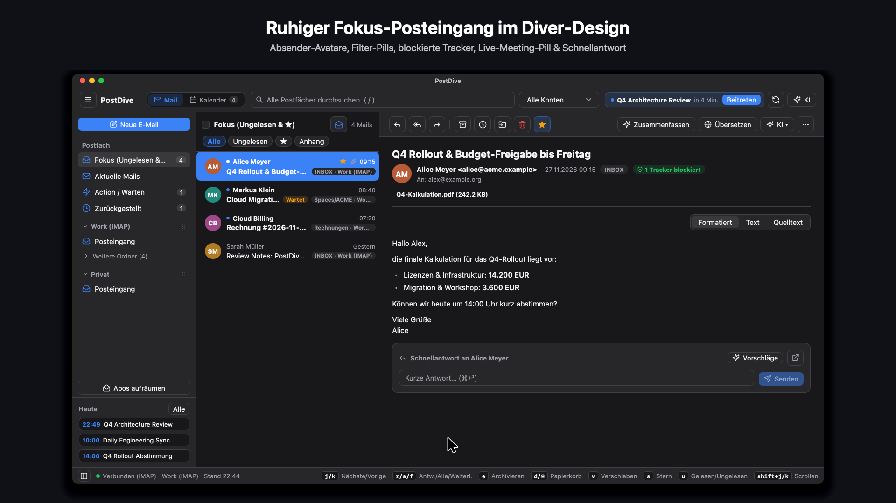
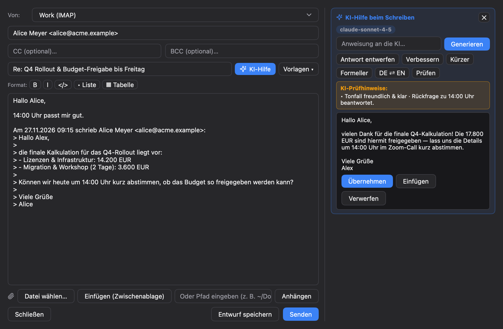

<p align="center">
  
</p>

<h1 align="center">PostDive</h1>

<p align="center">
  <strong>Native Email, Calendar &amp; Contacts Suite with Flexible Local &amp; Cloud AI</strong><br/>
  <em>Nativer E-Mail-, Kalender- &amp; Kontakt-Client mit flexibler lokaler &amp; Cloud-KI</em>
</p>

<p align="center">
  <a href="https://diver80.github.io/postdive/?lang=en">🌐 Website (EN)</a> ·
  <a href="https://diver80.github.io/postdive/?lang=de">🌐 Webseite (DE)</a> ·
  <a href="https://diver80.github.io/postdive/#tour">🎬 Feature Tour</a> ·
  <a href="https://github.com/diver80/postdive/releases/latest">⬇️ Latest Release</a> ·
  <a href="docs/MCP.md">🔌 MCP Server</a> ·
  <a href="docs/LOCAL_AI.md">🤖 Local AI Guide</a> ·
  <a href="docs/ARCHITECTURE.md">📐 Architecture</a> ·
  <a href="docs/SETUP.md">🧩 Setup: Mail, Google &amp; Outlook</a> ·
  <a href="docs/HISTORY.md">🗺️ Milestones</a> ·
  <a href="LICENSE">⚖️ MIT License</a>
</p>


> **Status (EN):** Actively in development and **used daily on macOS**. Prebuilt binaries for macOS, Linux, and Windows are attached to every release; Android builds are supported via `mygo`. **Testers, feedback, and Pull Requests are very welcome!** Licensed under **MIT**.
>
> **Status (DE):** Aktiv in Entwicklung und **täglich auf macOS im produktiven Einsatz**. Fertige Binaries für macOS, Linux und Windows hängen an jedem Release; Android-Builds laufen über `mygo`. **Tester, Feedback und Pull-Requests sind herzlich willkommen!** Lizenz: **MIT**.

---

## Highlights (EN)

- **Diver Default Theme & Calm Mail Redesign:** New warm dark **Diver** and crisp **Diver Light** themes (default across 24 built-in themes + live Omarchy theme sync). Cleaner **Focus (`Unread & ★`)** inbox with sender avatars, filter pills (**All / Unread / ★ / Attachments**), a **tracker-pixel counter pill**, **Snooze** (`Later Today` / `Tomorrow` / `Next Week` with auto wake-up), zero-token **Waiting-for-Reply** reminders, and a **Subscriptions & Newsletter Cleanup** manager with SSRF-guarded RFC 8058 One-Click unsubscribe.
- **Consistent Right-Side AI Dock & Inline Quick-Reply:** Open the AI pane consistently on the **right side** in both the main workspace (summarize, translate, extract events/contacts, copilot chat) and detached Compose/Reply windows (`✨ AI Assist`), plus inline **Quick-Reply** in the reading pane with optional AI reply chips and Undo-Send support. **Encrypted/decrypted S/MIME & OpenPGP mails are strictly blocked from ever being sent to any AI backend.**
- **Flexible AI & 1-Click MCP Client Setup:** Run completely locally via **MTPLX** ([Inkling 2 Mini](docs/LOCAL_AI.md) on Apple Silicon), **Ollama**, `llama.cpp`, or `llamafile` — or connect **Anthropic Claude**, **Google Gemini**, **OpenAI**, and sandboxed CLI agents (`claude-cli`, `agy`, `opencode-cli`) with **Personal AI Instructions** and live model dropdowns. Connect **Claude Code**, **Claude Desktop**, **Cursor**, **Antigravity**, or **T3 Code** via the built-in local stdio MCP server (`postdive --mcp`, read-only by default) with **1-click client setup** & config copy in **Settings → AI & Sync** ([docs/MCP.md](docs/MCP.md)). Local filter rules (incl. **header-based AI filter suggestions**) run at **0 tokens**.
- **Cron-Style Integrated Calendar:** **24h Day / Week / Month / Agenda** views (Week & Day on 24h timelines), collapsible **mini-month + multi-account calendar sidebar** with color visibility toggles, a **Live-Meeting toolbar pill** (`now` / `in Xm`) with 1-click Join for Teams/Meet/Zoom/Webex, inline `.ics` RSVP with **Free/Busy conflict badge** & target calendar picker, and two-way **Google Calendar & CalDAV** sync.
- **Native Performance, Security & Privacy:** Single compiled Go binary + GPU-accelerated [mygo](https://github.com/egoist/mygo) UI — zero Electron/Chromium memory overhead. Instant SQLite FTS5 full-text search, IMAP IDLE, **Formatted / Text / Source** reader (all RFC 5322 headers), embedded **Web Preview** (Jira/Atlassian work items), full **S/MIME** (`.p12`, team bulk cert import, encrypted `.ics` & attachments) & **native OpenPGP** (PGP/MIME & Inline PGP without external `gpg`), strict HTML sanitizer & remote-image blocking, TLS/STARTTLS-only transport, encrypted **LAN QR-code** device transfer (AES-256-GCM), and 1-click read-only **Thunderbird import**.
- **Cross-Platform Parity:** Native builds for **macOS** (Apple Silicon & Intel `.app`), **Linux** (`x64`/`arm64`, Omarchy live sync), **Windows** (`x64`/`arm64`), and **Android** (`mygo` phone layout with swipe actions, filter pills, Snooze, Quick-Reply, Live-Meeting bar, and WorkManager background sync).

---

## Highlights (DE)

- **Diver-Standard-Theme & Ruhiges Mail-Redesign:** Neue Standard-Themes **Diver** (warm-dunkel) und **Diver Light** (unter 24 eingebauten Themes + Omarchy-Live-Sync). Aufgeräumter **Fokus (Ungelesen & ★)** mit Absender-Avataren, Filter-Pills (**Alle / Ungelesen / ★ / Anhang**), **Tracker-Blocker-Zähler**, **Zurückstellen (Snooze)** mit automatischer Wiedervorlage, **0-Token-Ansicht „Wartet auf Antwort“** und **Abos & Newsletter aufräumen** inkl. geschützter 1-Klick-Abmeldung.
- **Konsistentes KI-Panel rechts & Schnellantwort:** Der KI-Assistent sitzt jetzt einheitlich **rechts** — sowohl im Hauptfenster (Zusammenfassen, Übersetzen, Termin-/Kontakterkennung, Copilot-Chat) als auch im eigenen Verfassen-/Antworten-Dialog (**✨ KI-Hilfe**), ergänzt durch eine **Schnellantwort-Leiste** mit optionalen KI-Chips im Lesebereich (inkl. Undo-Send). **Verschlüsselte/entschlüsselte S/MIME- & PGP-Mails werden aus Datenschutzgründen niemals an KI-Anbieter gesendet.**
- **Flexible KI & 1-Klick-MCP-Setup:** Komplett lokal mit **MTPLX** ([Inkling 2 Mini](docs/LOCAL_AI.md) auf Apple Silicon), **Ollama**, `llama.cpp` oder `llamafile` – oder flexibel mit **Anthropic Claude**, **Google Gemini**, **OpenAI** sowie CLI-Agenten (`claude-cli`, `agy`, `opencode-cli`) inkl. **Live-Modell-Dropdowns** und **Persönlicher KI-Hinweise**. Verbindet **Claude Code**, **Claude Desktop**, **Cursor**, **Antigravity** oder **T3 Code** lokal über `postdive --mcp` (standardmäßig Read-Only) – inkl. **1-Klick-Client-Einrichtung** in **Einstellungen → KI & Sync** ([docs/MCP.md](docs/MCP.md)). Lokale Filterregeln laufen mit **0 Tokens**.
- **Kalender im Cron-Stil:** **24h-Tag / Woche / Monat / Agenda**, einklappbare **Seitenleiste mit Mini-Monat & Kalender-Filter** inkl. Farbpunkten, **Live-Meeting-Pill** in der Toolbar (`jetzt` / `in Xm`) mit direktem Beitritts-Button (Teams/Meet/Zoom), sowie **Frei/Belegt-Prüfung** bei `.ics`-Einladungen mit Zielkalender-Auswahl und bidirektionaler **Google- & CalDAV**-Synchronisation.
- **Native Performance, Sicherheit & Datenschutz:** Ein einziges kompiliertes Go-Binary mit GPU-beschleunigter [mygo](https://github.com/egoist/mygo)-Oberfläche ohne Electron-Ballast. Sofortige SQLite-FTS5-Suche, IMAP IDLE, **Formatiert / Text / Quelltext**-Ansicht, eingebettete Jira-Vorschau, vollständiges **S/MIME** & **natives OpenPGP** (ohne externes `gpg`), blockierte Remote-Bilder, strikter HTML-Sanitizer, nur TLS/STARTTLS, **LAN-QR-Code-Transfer** (AES-256-GCM) und rein lesender **1-Klick-Thunderbird-Import**.
- **Plattformübergreifend konsistent:** Native Builds für **macOS** (Universal `.app`), **Linux** (`x64`/`arm64`, Omarchy), **Windows** (`x64`/`arm64`) und **Android** (Telefon-UI mit voller Feature-Parität: Filter-Pills, Snooze, Schnellantwort, Live-Meeting-Leiste & Hintergrund-Sync).

---

## Feature Tour Video (55s · 1080p)

[](https://diver80.github.io/postdive/#tour)

▶ **[Watch inline on website (EN)](https://diver80.github.io/postdive/?lang=en#tour)** · **[Im Browser ansehen (DE)](https://diver80.github.io/postdive/?lang=de#tour)** · **[Download MP4 (2.7 MB)](https://github.com/diver80/postdive/releases/download/v0.8.0/postdive-tour.mp4)**

---

## Screenshots

| Focus Inbox & Right-Side AI Dock (Diver Dark) | Calendar Week Grid & Sidebar (Diver Light) |
|---|---|
|  |  |

| Reply & Compose with Right-Side AI Assist | Quick-Rule Wizard & Unified AI / MCP Settings |
|---|---|
|  |  |

---

## Quick Start / Installation

### Homebrew (macOS & Linux)

```bash
# macOS (Universal PostDive.app + postdive CLI)
brew install --cask diver80/tap/postdive

# Linux / CLI binary
brew install diver80/tap/postdive
```

### Arch Linux / Omarchy (PKGBUILD)

```bash
git clone --depth=1 https://github.com/diver80/postdive.git /tmp/postdive-aur \
  && cd /tmp/postdive-aur/packaging/aur/postdive-bin \
  && makepkg -si
```

*(The Arch `PKGBUILD` and `.SRCINFO` live in [`packaging/aur/postdive-bin/`](packaging/aur/postdive-bin). PostDive follows Omarchy themes live via `~/.local/state/omarchy/current/theme/colors.toml`.)*

### Local MCP Server (Claude Code, Claude Desktop, Cursor, Antigravity)

```bash
# Claude Code (read-only by default; add --allow-drafts or --allow-writes optionally)
claude mcp add postdive -- postdive --mcp
```

Full setup snippets, tool list, and security guarantees: **[docs/MCP.md](docs/MCP.md)** (also available with 1-click copy inside **PostDive → Settings → AI & Sync**).

### GitHub Releases or Build from Source

Download the latest prebuilt release from [GitHub Releases](https://github.com/diver80/postdive/releases/latest), or build from source (Go 1.27+):

```bash
git clone https://github.com/diver80/postdive.git
cd postdive
./build.sh        # tests, macOS PostDive.app, Linux/Windows/macOS binaries + SHA256SUMS
./install.sh      # installs postdive to ~/.local/bin and PostDive.app to ~/Applications (set POSTDIVE_APP_DIR=/Applications for /Applications)
```

Additional build targets:

```bash
./build.sh --packages                                                    # .dmg / .deb / .rpm / PKGBUILD / Windows installer
./build.sh --android                                                     # Android APK/AAB (requires Android NDK)
POSTDIVE_RENDER=docs/screenshots go test ./internal/nativeui -run TestRenderScreens
```

## Contributing & License

Testers (especially on Linux, Windows, and Android), bug reports, feature discussions, and Pull Requests are warmly welcome!

Licensed under the **MIT License** — see [LICENSE](LICENSE).
