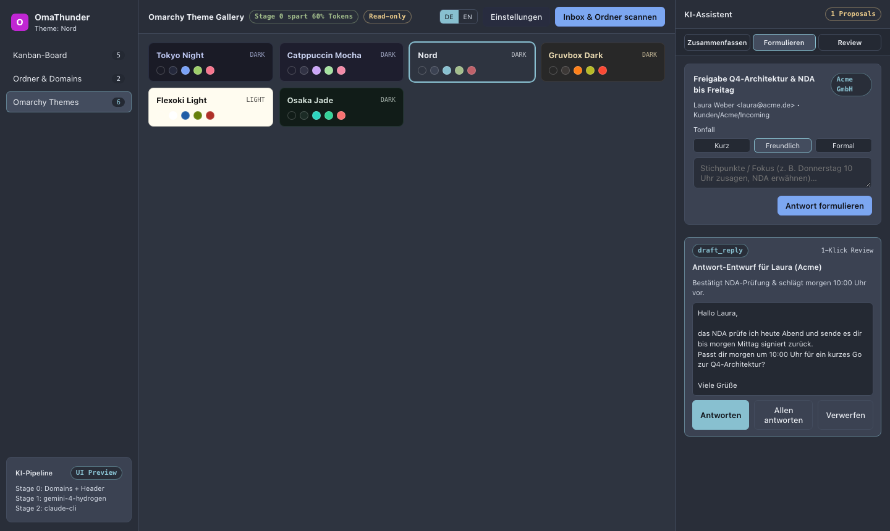

# OmaThunder

**Omarchy themes, an AI writing assistant and mail triage for Thunderbird – on Omarchy Linux and macOS.**

OmaThunder consists of a Thunderbird add-on and a small helper program (Go) that runs locally next to Thunderbird. Its three building blocks can be switched on individually:

| Building block | What it does | Default |
|---|---|---|
| **Theme sync** | Colors Thunderbird in one of 22 Omarchy themes. On Omarchy it follows the active theme live. | on |
| **AI writing assistant** | Summarizes mails, drafts replies, reviews and improves your drafts – right in the compose window. | on |
| **Triage** | Scans the inbox and customer folders, sorts mails onto a Kanban board and moves mails from customer domains into their folders. | off |

Nothing is sent or deleted automatically. Changes to mails, folders or tags are blocked by default (read-only).

Optionally there is also a **native desktop app** (`omathunder ui`, on macOS `OmaThunder.app`) with mail cockpit, calendar, quick rules and an AI copilot. It talks to Thunderbird through a local, token-protected bridge that is **off by default** – see [Native app & local bridge](#native-app--local-bridge-optional).

> **Status:** early version (0.2). The Go host and the core logic are covered by unit tests; running inside Thunderbird has seen little real-world use so far. Windows builds are produced but untested.

---

## Installation

Requires Thunderbird 128 or newer.

### Homebrew (macOS, Linux)

```bash
brew install diver80/tap/omathunder
omathunder setup        # registers the helper program with Thunderbird (once)
```

Then in Thunderbird: **Add-ons and Themes → gear icon → Install Add-on From File** and pick:

```
$(brew --prefix)/opt/omathunder/share/omathunder/omathunder-extension.xpi
```

`omathunder setup` prints the exact path. After `brew upgrade omathunder`, install the `.xpi` again so add-on and helper program match – the settings page warns when they don't.

### From source

```bash
git clone https://github.com/diver80/omathunder.git && cd omathunder
./build.sh        # tests, binaries and dist/omathunder-extension.xpi
./install.sh      # binary to ~/.local/bin, registration with Thunderbird
```

Then install `dist/omathunder-extension.xpi` in Thunderbird as described above.

`setup` and `install.sh` only create the native messaging registration and a small launcher script. They never touch Thunderbird's profile or `prefs.js`.

---

## Getting started

1. **Open the settings** (add-on options, or the button in the OmaThunder tab). Everything under **Status** should be green: host connected, versions match, AI backend found.
2. **Use theme and writing assistant.** Leave triage off.
3. **Switch triage on, keep read-only on.** Enable only the account that holds your customer folders and leave AI classification off. Run a scan and check the **dry run**: it lists which mails would be moved.
4. Check your rules (column **Account**) and enable auto-move per rule where you want it.
5. Only then **switch read-only off**. Every scan can be undone afterwards via "Undo this scan's moves".

---

## Writing assistant


* **In the compose window** ("OmaThunder AI" button): improve your draft, review it against the original mail, draft a reply, or write a mail from notes. The result shows up in the popup first; only "insert" writes it into the draft. Only your own text is replaced – quote and signature stay untouched.
* **On the open mail** ("OmaThunder AI" button): summarize or draft a reply, also as "Reply all".
* **In the OmaThunder tab:** the same functions for the open mail or a board card, including a review of your draft.

The conversation is used as context, linked through the `References` / `In-Reply-To` headers – not just by a matching subject. Every request is a single AI call, triggered by your click.


## Triage: Kanban and customer rules


* **Board** with five columns (Incoming, Action needed, Waiting, Invoice/Event, Done), filter by customer, drag & drop. Cards open the mail in Thunderbird.
* **Customer rules** map sender domains to a customer folder. Optionally OmaThunder moves new inbox mails there and maps board columns to subfolders (e.g. "Done").
* **Stage 0 (local, 0 tokens):** newsletters, bot mails, out-of-office replies and invoices are recognized by headers and subject. Security and transaction mails (password resets, codes, orders) are never automatically marked as unimportant.
* **Stage 1 (optional, AI):** whatever stage 0 cannot place is classified by a fast model – Gemini API, Claude API, Ollama (local) or a CLI.


### Token usage

* Scans only run on click (optionally also on new mail) and only cover the newest **20 mails per folder** from the last **30 days**.
* **AI classification is off by default** – a scan then costs nothing and the classification is a local estimate.
* When it is on, a hard limit of **50 AI calls per scan** applies, unread mails first. Mails that were already classified are not sent again.
* The scan report shows how many calls were made and how many mails were only estimated.

All values can be changed in the settings.

## Theme sync



* Colors toolbars, tabs, folder pane and popups through Thunderbird's theme API – no restart needed.
* Optionally also message bodies and the editor (off by default, because HTML mails with fixed text colors can otherwise become hard to read).
* **Omarchy:** follows `~/.local/state/omarchy/current/theme/colors.toml` live.
* **macOS:** pick one of the 22 bundled Omarchy themes (gallery, popup, settings or `omathunder theme set nord`) or follow the system's light/dark mode.


---

## Safety

| Protection | Effect |
|---|---|
| **Read-only** (default) | No changes to mails, folders or tags. Scans only report planned moves as a dry run. Reply drafts still open – nothing is ever sent automatically. |
| **Triage per account** | Only enabled accounts are scanned, sent to the AI and changed. Moving mails between accounts is blocked. |
| **Narrow auto-move** | Only from the inbox, only on a sender-domain match, optionally only unread mails, never out of customer folders. Mails for which the mail server recorded a failed DKIM/DMARC check are never moved (forged sender). Each mail is checked again in the mailbox right before it is moved. |
| **Unambiguous mail lookup** | Stored mails are found again by their Message-ID. If the match is ambiguous, nothing happens. |
| **Undo** | Moves of a scan or of a deleted rule can be undone – but only for mails still in the folder OmaThunder put them in. |
| **No automatic deleting or sending** | The add-on holds `messagesDelete` and `compose.send`, but uses them only on explicit request: deleting only in *Archive & Cleanup* after a verified export (or as "move to trash" from the app), sending only through the bridge's send endpoint, which additionally needs `bridge.allowSend` (off by default) and read-only off. AI output never sends or deletes anything. |
| **Local bridge (optional)** | Off by default. When enabled it listens on `127.0.0.1` only and requires a random 256-bit token from a `0600` file. Bridge clients can read all accounts unless `bridge.accountIds` limits them; every write needs read-only off and an account enabled for triage. Filters created through the bridge can never delete mail. |
| **AI copilot (app)** | Mail content is passed to the model as untrusted data. The copilot only *proposes* drafts, calendar entries and status changes – nothing happens until you click "Execute". |
| **AI backends** | The Claude CLI runs without tools and without MCP servers and receives the mail text via stdin. Gemini CLI and OpenCode CLI cannot be started without tools and stay blocked until you explicitly allow them. |

Mail content only goes to the AI backend you chose in the settings. With Ollama everything stays on your machine. API endpoints come only from your settings, never from a bridge request, and an API key is only sent to the endpoint configured for that provider.

## Settings


### Setting up AI access

Thunderbird starts the helper program without your shell environment, so API keys are read from a separate file:

* macOS: `~/Library/Application Support/omathunder/env`
* Linux: `~/.config/omathunder/env`

```bash
export GEMINI_API_KEY=...        # backend "Gemini API"
export ANTHROPIC_API_KEY=...     # backend "Anthropic Claude API"
```

Restart Thunderbird afterwards. The Claude CLI needs no entry; it uses its own login. The **Status** section of the settings shows whether keys and programs were found.

---

## Command line

```bash
omathunder ui               # start the native app (omathunder-ui / OmaThunder.app)
omathunder bridge enable    # switch the local bridge on (… disable / status / path)
omathunder setup            # register with Thunderbird
omathunder doctor           # status: Omarchy, CLIs, API keys, registration
omathunder theme list       # all 22 themes
omathunder theme set nord   # set a theme directly
omathunder bar-summary      # numbers for the Omarchy bar
omathunder classify --subject "..." --from "..." --body "..."   # test classification (calls the AI)
omathunder uninstall        # remove registration, settings and state
```

## Native app & local bridge (optional)

The native app (`omathunder ui`; on macOS `~/Applications/OmaThunder.app`) is a separate program from the small helper that Thunderbird starts. It shows mails, calendar and contacts, creates **quick rules** from selected mails and has an AI copilot.

It needs the **local bridge**, which is off by default. Switch it on in the app ("Enable bridge"), in the add-on settings or with `omathunder bridge enable`; the helper opens the port within about two seconds while Thunderbird runs. Details, endpoints and the safety model: [docs/BRIDGE.md](docs/BRIDGE.md).

* **Quick rules** create a real Thunderbird filter (appended after your own filters) and can apply it to the selected mails right away. Rules that would be too broad (e.g. a whole free-mail domain) are flagged and need a second confirmation. **Editing, sorting, enabling/disabling and deleting filters happens in Thunderbird** (*Tools → Message Filters*).
* **Copilot** answers questions about your mails and calendar. Drafts, calendar entries and "mark as read" are shown as proposals and only run after you click *Execute*.
* **Reading pane:** HTML mails are shown formatted (headings, lists, quotes, links by their title) without loading anything from the internet — no tracking pixels, no remote images; a "Formatted / Text" switch shows the text version.
* **Keyboard:** `j`/`k` next/previous mail, `x` check, `e` archive, `d` trash, `v` move to…, `s` star, `u` read/unread, `r` reply, `esc` back, `/` search, `c` compose, `h` help. The footer always lists the keys that apply right now. Single keys never fire while you type in a field; `d` on several checked mails needs a second press.

## Uninstall

```bash
omathunder uninstall && brew uninstall omathunder   # Homebrew
./uninstall.sh                                      # installed from source
```

Then remove the add-on in Thunderbird's add-on manager. `uninstall` also deletes your rules and settings. Mails and the Thunderbird profile stay untouched.

## Development

```bash
go test ./...               # host, bridge, AI layer, native app
node tests/core.test.js     # add-on core logic (macOS without Node: jsc tests/core.test.js)
./build.sh                  # both test runs, binaries for macOS/Linux/Windows, .xpi, OmaThunder.app, SHA256SUMS
./release.sh                # tag, GitHub release and values for the Homebrew formula
```

Two programs are built from `cmd/`: `omathunder` (Native Messaging host + CLI, no GUI dependencies) and `omathunder-ui` (the native app, bundled on macOS as `OmaThunder.app` via [mygo](https://github.com/egoist/mygo)). Building needs Go 1.27.3 or newer, because mygo requires it. The Homebrew formula should build both (`go build ./cmd/omathunder ./cmd/omathunder-ui`) so that `omathunder ui` finds the app next to the helper.

Architecture and safety model: [docs/ARCHITECTURE.md](docs/ARCHITECTURE.md).

## License

MIT – see [LICENSE](LICENSE).
