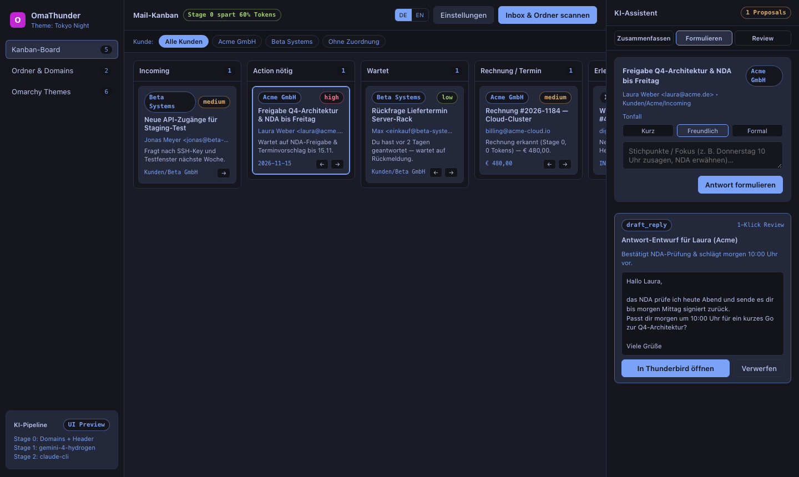
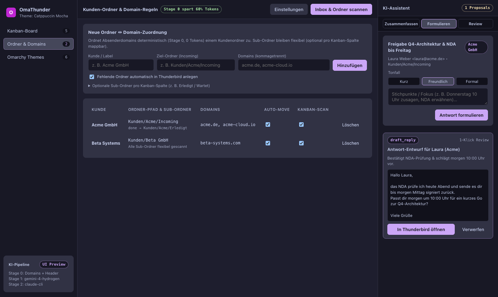
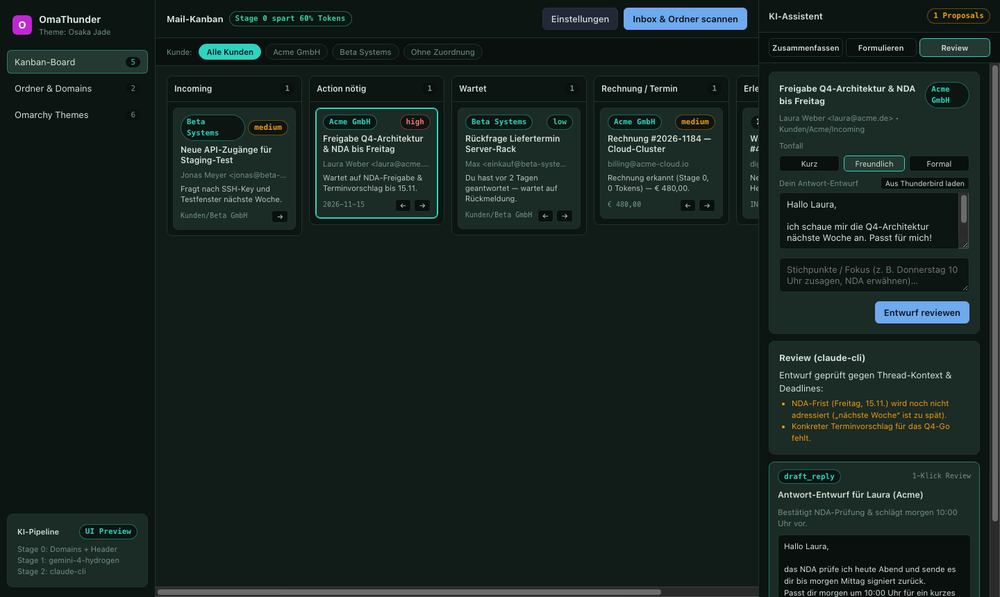
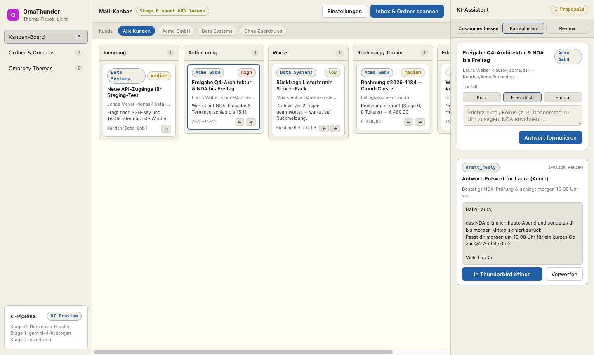
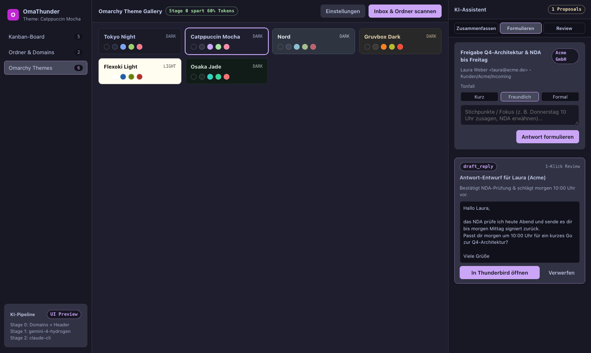

# OmaThunder

**Live Omarchy Theme Sync + Mail-Kanban + Kunden-Domain-Routing + 3-Stufen-KI-Assistent für Thunderbird — für Omarchy Linux, macOS & Windows.**

* **Kein Eingriff am Profil vorbei:** Reine WebExtension (`extension/`) ohne `experiment_apis`. Der Installer fasst weder `prefs.js` noch Mail-Daten an. Alles, was OmaThunder in Thunderbird ändert (Mails verschieben, Tags setzen, Status-Tags `oma-*` anlegen), läuft über die offiziellen Add-on-Schnittstellen und nur, wenn Read-only aus ist. Rückstandslos entfernbar über [`uninstall.sh`](uninstall.sh).
* **Live-Themes ohne Neustart:** Färbt Toolbars, Tabs, Sidebars (`browser.theme.update`) **und** Mail-Body/Compose-Editor (`messageDisplayScripts` / `composeScripts`). Unter Omarchy live aus `~/.local/state/omarchy/current/theme/colors.toml`, unter macOS/Windows aus 22 eingebetteten Omarchy-Paletten (inkl. System-Dark/Light-Follow).
* **Kunden-Ordner & Domain-Regeln (mit Incoming-Rollback):** Ordnet Absender-Domains deterministisch (Stage 0, 0 Tokens) einem Kundenordner zu. Sub-Ordner bleiben flexibel (alle Sub-Ordner werden mitgescannt oder optional pro Kanban-Spalte gemappt). Beim Löschen einer Regel lassen sich automatisch einsortierte Mails per Checkbox zurück in **Incoming (INBOX)** verschieben.
* **Mail-Kanban-Board:** 5 Spalten (`Incoming` → `Action nötig` → `Wartet` → `Rechnung / Termin` → `Erledigt`) mit Drag & Drop, Kunden-Filter-Pills und `oma-*` Status-Tags.
* **3-Stufen-KI & 3 Arbeitsmodi:**
  * **Stage 0 (0 Tokens):** Domain-Routing + Header-Regeln (Newsletter, CI-Bots, Abwesenheitsnotizen, Rechnungen). Sicherheits- und Transaktionsmails (Passwort-Reset, Codes, Bestellungen) werden nie automatisch als unwichtig eingestuft.
  * **Stage 1 (Fast Classifier):** Strukturiertes JSON via **Gemini Hydrogen / Flash**, **Claude Haiku** oder lokal **Ollama**.
  * **Stage 2 (Assistent mit 3 Modi):** **Zusammenfassen**, **Antwort formulieren** (Tonfall *Kurz / Freundlich / Formal*) und **Review** (prüft deinen eigenen Entwurf aus Thunderbird gegen den Thread auf vergessene Punkte/Deadlines). Alle Vorschläge landen zuerst als reviewbare **Proposals**.

## Funktionen & Sicherheit

Die drei Bausteine lassen sich in den Einstellungen einzeln schalten: **Theme-Sync**, **KI-Schreibassistent** und **Triage** (Scan, Kanban, Kunden-Regeln, Auto-Move). Standard für neue und bestehende Installationen: Theme und Assistent an, Triage aus.

* **Read-only (Standard):** OmaThunder ändert keine Mails, Ordner oder Tags. Ein Scan zeigt geplante Verschiebungen nur als Probelauf. Antwort-Entwürfe öffnen sich weiterhin als Compose-Fenster, gesendet wird nie automatisch.
* **Triage pro Konto:** Nur freigegebene Konten werden gescannt, an die KI-Klassifikation geschickt und verändert. Verschieben zwischen Konten ist gesperrt.
* **Auto-Move nur aus der INBOX:** nur bei Treffer über die Absender-Domain, optional nur ungelesene Mails, und nie aus Kundenordnern oder deren Unterordnern heraus.
* **Sichere Mail-Zuordnung:** Gespeicherte Mails werden über ihre Message-ID wiedergefunden. Ist der Treffer nicht eindeutig, passiert nichts.
* **CLI-Backends:** Die Claude-CLI läuft ohne Werkzeuge und erhält den Mailtext über stdin. `gemini-cli` und `opencode-cli` lassen sich nicht ohne Werkzeuge starten und sind deshalb gesperrt, bis du sie in den Einstellungen ausdrücklich erlaubst.
* **Löschen und Senden** sind technisch ausgeschlossen (keine Berechtigungen `messagesDelete` / `compose.send`).

---

## Screenshots







---

## Build (macOS / Linux / Windows)

```bash
./build.sh
```

Erzeugt in `dist/` alle Cross-Compile-Binaries (`darwin/arm64`, `darwin/amd64`, `linux/amd64`, `linux/arm64`, `windows/amd64.exe`, `windows/arm64.exe`), das installierbare Add-on `dist/omathunder-extension.xpi` sowie `SHA256SUMS.txt`.

## Sichere Installation & Deinstallation

```bash
# Installiert Go-Binary nach ~/.local/bin und registriert NUR den Native Messaging Host
./install.sh

# Entfernt Binary, Native Messaging Host & omathunder-State vollständig (Thunderbird bleibt unberührt)
./uninstall.sh
```

Danach in Thunderbird: **Add-ons & Themes → Zahnrad → Add-on aus Datei installieren → `dist/omathunder-extension.xpi`**.

*(Hinweis zur Signatur bei lokalem `.xpi` vor ATN-Release: Zum schnellen Testen in Thunderbird lässt sich das Add-on über „Temporäres Add-on laden“ (`about:debugging`) testen, ohne irgendwelche Signatur-Einstellungen im Profil zu verändern.)*

## Tests

```bash
go test ./...                 # Host: Config, Auto-Move-Regeln, Durchsetzung von Funktionen/Read-only
node tests/core.test.js       # Extension-Kernlogik (macOS ohne Node: jsc tests/core.test.js)
```

`./build.sh` führt beide Testläufe vor dem Paketieren aus.

## CLI-Befehle

```bash
omathunder doctor           # Prüft Omarchy-Erkennung, CLIs (claude/gemini/opencode/ollama) & Manifeste
omathunder theme list       # Zeigt alle 22 eingebetteten Omarchy-Paletten
omathunder theme set nord   # Schaltet Preset direkt um
omathunder classify --subject "..." --from "..." --body "..."
```

## Architektur

Siehe [docs/ARCHITECTURE.md](docs/ARCHITECTURE.md).
