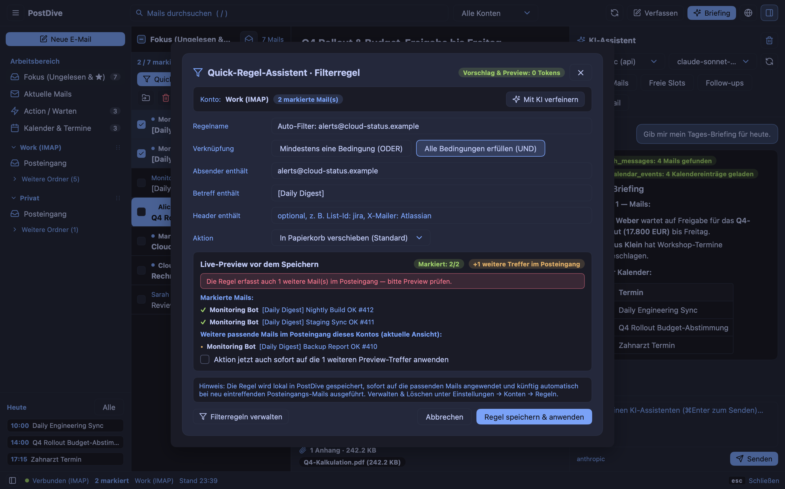

<p align="center">
  
</p>

<h1 align="center">MailDiver</h1>

<p align="center">
  <strong>Native Email, Calendar &amp; Contacts Suite with Flexible Local &amp; Cloud AI</strong><br/>
  <em>Nativer E-Mail-, Kalender- &amp; Kontakt-Client mit flexibler lokaler &amp; Cloud-KI</em>
</p>

<p align="center">
  <a href="https://diver80.github.io/maildiver/?lang=en">🌐 Website (EN)</a> ·
  <a href="https://diver80.github.io/maildiver/?lang=de">🌐 Webseite (DE)</a> ·
  <a href="https://github.com/diver80/maildiver/releases/latest">⬇️ Latest Release</a> ·
  <a href="docs/LOCAL_AI.md">🤖 Local AI Guide</a> ·
  <a href="docs/ARCHITECTURE.md">📐 Architecture</a> ·
  <a href="LICENSE">⚖️ MIT License</a>
</p>


> **Status (EN):** Actively in development and **used daily on macOS**. Prebuilt binaries for macOS, Linux, and Windows are attached to every release; Android builds are supported via `mygo`. **Testers, feedback, and Pull Requests are very welcome!** Licensed under **MIT**.
>
> **Status (DE):** Aktiv in Entwicklung und **täglich auf macOS im produktiven Einsatz**. Fertige Binaries für macOS, Linux und Windows hängen an jedem Release; Android-Builds laufen über `mygo`. **Tester, Feedback und Pull-Requests sind herzlich willkommen!** Lizenz: **MIT**.

---

## Highlights (EN)

- **Flexible AI — Local & Cloud:** Run completely locally via **MTPLX** ([Inkling 2 Mini](docs/LOCAL_AI.md) on Apple Silicon), **Ollama**, `llama.cpp`, or `llamafile` (see [docs/LOCAL_AI.md](docs/LOCAL_AI.md)) — or connect **Anthropic Claude**, **Google Gemini**, **OpenAI**, and CLI agents (`claude-cli`, `gemini-cli`, `opencode-cli`) with live model dropdowns in both the AI panel and Settings. Deterministic local filter rules run at **0 tokens**, and the AI copilot only *proposes* actions until you click Execute.
- **Native Performance & Smart Compact Sidebar:** Single compiled Go binary + GPU-accelerated [mygo](https://github.com/egoist/mygo) UI — zero Electron/Chromium memory overhead. Local SQLite FTS5 full-text search across your entire mailbox history, real-time IMAP IDLE, Focus (`Unread & ★` so important starred emails stay pinned), **smart compact folder sidebar** (shows only `INBOX` and active incoming filter-rule target folders per account while collapsing Archives/Drafts/Sent/Trash/Spam into an expandable *“More folders”* block so all accounts stay visible at a glance on both phone and desktop, customizable per mailbox), keyboard-first shortcuts (`j`/`k`/`r`/`e`/`v`/`c`/`s`/`⌘K`), and detached native windows for Compose & Calendar Events.
- **Security & Privacy (S/MIME & Native OpenPGP):** Full **S/MIME** (`.p12`/`.pfx` import with OS Keychain private keys, signature verification, decryption, signing & AES-256-CBC encryption) AND **native OpenPGP** (PGP/MIME RFC 3156 & Inline PGP with zero external `gpg`, RSA-3072 key generation, passphrase-protected OS Keychain storage, WKD / `keys.openpgp.org` lookup with SSRF/key-binding guards), remote images blocked by default with persistent per-sender allowlist, strict HTML sanitizer, pixel-bomb & SSRF guards, TLS/STARTTLS-only transport, encrypted **LAN QR-code** device transfer (AES-256-GCM), and risky attachment protection.
- **Complete Suite (Email, Calendar & Contacts):** Multi-account IMAP/SMTP (incl. **Gmail & Microsoft 365 XOAUTH2**) with newest-on-top conversations, **Offline Outbox** queue, desktop **HTML WYSIWYG compose editor** (inline pasted images, editable HTML tables, drag & drop / clipboard files), inline `.ics` RSVP, Month/Week/Agenda calendar with **Google Calendar & CalDAV** sync + 1-click Teams/Meet/Zoom join links, and unified local + Google + **CardDAV** Contacts with autocomplete.
- **Effortless Setup (Thunderbird Import & LAN QR):** 1-click read-only Thunderbird profile importer brings over accounts, signatures, calendars, contacts, and filter rules in seconds — plus provider presets, full inline Filter Rule Editor, and one-shot AES-256-GCM LAN QR setup transfer to another desktop or Android phone.
- **Cross-Platform:** Native builds for **macOS** (Apple Silicon & Intel `.app`), **Linux** (`x64`/`arm64`, live Omarchy theme sync), **Windows** (`x64`/`arm64`), and **Android** (`mygo`, swipe actions + long-press multi-select, WorkManager background sync).

---

## Highlights (DE)

- **KI flexibel (Lokal & Cloud):** Komplett lokal mit **MTPLX** ([Inkling 2 Mini](docs/LOCAL_AI.md) auf Apple Silicon), **Ollama**, `llama.cpp` oder `llamafile` (Anleitung in [docs/LOCAL_AI.md](docs/LOCAL_AI.md)) – oder mit **Anthropic Claude**, **Google Gemini**, **OpenAI** sowie CLI-Agenten (`claude-cli`, `gemini-cli`, `opencode-cli`) inkl. Modell-Dropdown in Copilot & Einstellungen. Lokale Filterregeln laufen mit **0 Tokens**, und der KI-Copilot *schlägt Aktionen nur vor* – nichts wird ohne deinen Klick ausgeführt.
- **Native Performance & Kompakte Ordneransicht:** Ein einziges kompiliertes Go-Binary mit GPU-beschleunigter [mygo](https://github.com/egoist/mygo)-Oberfläche ohne Electron-Ballast. Sofortige lokale SQLite-FTS5-Volltextsuche, Echtzeit-IMAP-IDLE, Fokus-Ansicht (**Ungelesen & ★** für markierte Mails), **kompakte Ordner-Seitenleiste** (zeigt pro Konto standardmäßig nur `INBOX` und aktive Filterregel-Zielordner direkt an und klappt Archiv/Entwürfe/Gesendet/Papierkorb/Spam platzsparend unter *„Weitere Ordner“* ein – so sind auf Handy & Desktop alle Konten ohne Scrollen im Blick, pro Postfach anpassbar), Tastatur-Bedienung (`j`/`k`/`r`/`e`/`v`/`c`/`s`/`⌘K`) und eigene native Fenster für Verfassen & Termine.
- **Sicherheit & Datenschutz (S/MIME & Natives OpenPGP):** Vollständiges **S/MIME** (`.p12`/`.pfx`-Import mit Schlüsseln im OS-Schlüsselbund, Signaturprüfung, Entschlüsselung, Signieren & AES-256-Verschlüsselung) UND **natives OpenPGP** (PGP/MIME RFC 3156 & Inline-PGP ohne externes `gpg`, RSA-3072-Schlüsselerzeugung, Passphrase-Schutz im Schlüsselbund, abgesicherter WKD-/VKS-Abruf), externe Bilder standardmäßig blockiert (mit dauerhafter Absender-Allowlist), strikter HTML-Sanitizer, Pixel-Bomb- & SSRF-Schutz, nur TLS/STARTTLS, verschlüsselter **LAN-QR-Code-Transfer** (AES-256-GCM) und Anhang-Schutz.
- **Komplette Suite (E-Mail, Kalender & Kontakte):** Multi-Konto IMAP/SMTP (inkl. **Gmail & Microsoft 365 XOAUTH2**) mit Unterhaltungen (neueste oben), **Offline-Postausgang**, **Desktop-HTML-WYSIWYG-Editor** (Copy&Paste von Bildern als `cid:`-Inline-Bild, bearbeitbare HTML-Tabellen, Drag & Drop / Zwischenablage-Anhänge), `.ics`-RSVP, Monats-/Wochen-/Agenda-Kalender mit **Google-Kalender & CalDAV** + direkten Teams/Meet/Zoom-Links sowie lokale, Google- & **CardDAV**-Kontakte.
- **Einfaches Setup (Thunderbird-Import & LAN-QR):** Rein lesender 1-Klick-Import aus Thunderbird übernimmt Konten, Signaturen, Kalender, Kontakte & Filterregeln automatisch – plus vollständiger Regel-Editor und einmaliger AES-256-GCM-QR-Code für die schnelle Einrichtung auf weiteren Geräten oder Android.
- **Plattformunabhängig:** Native Builds für **macOS** (Apple Silicon & Intel `.app`), **Linux** (`x64`/`arm64`, Omarchy-Live-Theme), **Windows** (`x64`/`arm64`) und **Android** (`mygo`, Wischgesten, Long-Press-Mehrfachauswahl & Hintergrund-Sync).

---

## Screenshots

| Conversations & Reading Pane | Calendar (Light Theme) |
|---|---|
|  |  |

| Quick-Rule Wizard & Filter Rules | Flexible AI & Privacy Settings |
|---|---|
|  |  |

---

## Quick Start / Installation

### Homebrew (macOS & Linux)

```bash
# macOS (Universal MailDiver.app + maildiver CLI)
brew install --cask diver80/tap/maildiver

# Linux / CLI binary
brew install diver80/tap/maildiver
```

### Arch Linux / Omarchy (AUR)

```bash
yay -S maildiver-bin
# or on Omarchy: Super + Space -> Install -> AUR -> maildiver-bin
```

*(The AUR `PKGBUILD` and `.SRCINFO` live in [`packaging/aur/maildiver-bin/`](packaging/aur/maildiver-bin) and follow Omarchy themes live via `~/.local/state/omarchy/current/theme/colors.toml`.)*

### GitHub Releases or Build from Source

Download the latest prebuilt release from [GitHub Releases](https://github.com/diver80/maildiver/releases/latest), or build from source (Go 1.24+ / 1.27+):

```bash
git clone https://github.com/diver80/maildiver.git
cd maildiver
./build.sh        # tests, macOS MailDiver.app, Linux/Windows/macOS binaries + SHA256SUMS
./install.sh      # installs maildiver to ~/.local/bin and MailDiver.app to ~/Applications
```

Additional build targets:

```bash
./build.sh --packages                                                    # .dmg / .deb / .rpm / PKGBUILD / Windows installer
./build.sh --android                                                     # Android APK/AAB (requires Android NDK)
MAILDIVER_RENDER=docs/screenshots go test ./internal/nativeui -run TestRenderScreens
```

## Contributing & License

Testers (especially on Linux, Windows, and Android), bug reports, feature discussions, and Pull Requests are warmly welcome!

Licensed under the **MIT License** — see [LICENSE](LICENSE).
