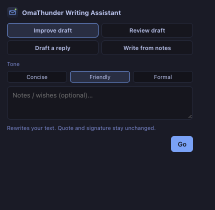
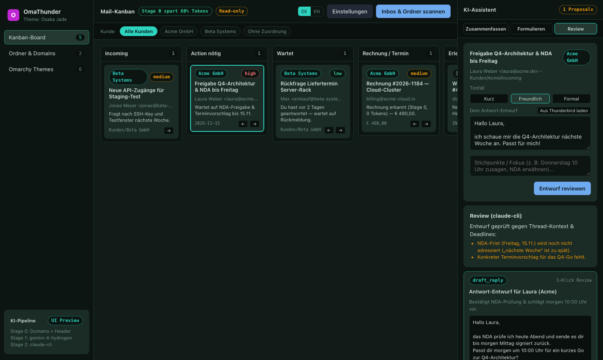
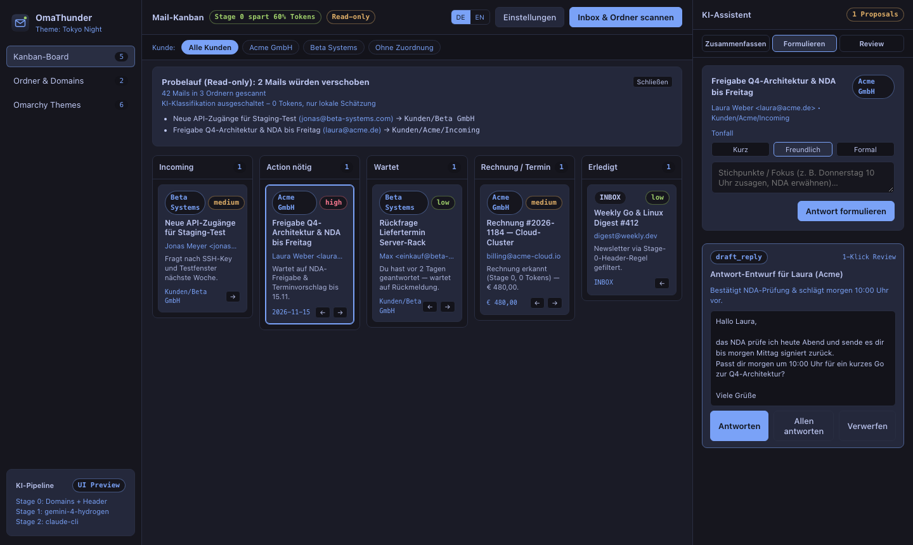
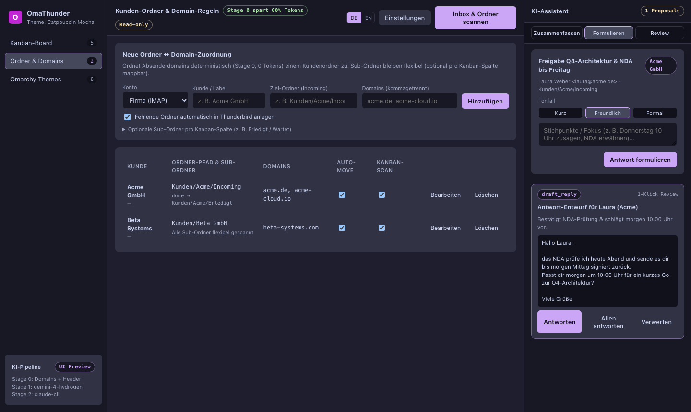
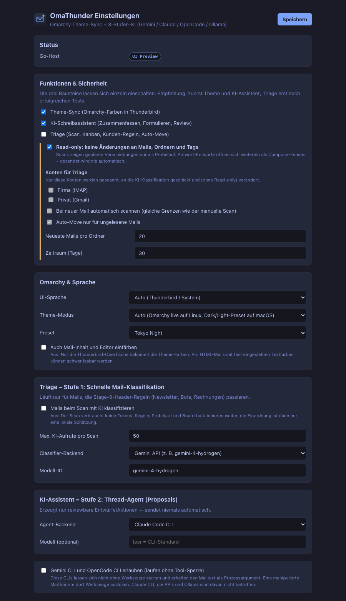

# OmaThunder

**Omarchy-Themes, KI-Schreibassistent und Mail-Triage für Thunderbird – auf Omarchy Linux und macOS.**

OmaThunder besteht aus einem Thunderbird-Add-on und einem kleinen Hilfsprogramm (Go), das lokal neben Thunderbird läuft. Die drei Bausteine lassen sich einzeln einschalten:

| Baustein | Was er tut | Standard |
|---|---|---|
| **Theme-Sync** | Färbt Thunderbird in einem der 22 Omarchy-Themes. Unter Omarchy folgt es live dem aktiven Theme. | an |
| **KI-Schreibassistent** | Fasst Mails zusammen, formuliert Antworten, prüft und verbessert deine Entwürfe – direkt im Verfassen-Fenster. | an |
| **Triage** | Scannt Posteingang und Kundenordner, sortiert Mails auf ein Kanban-Board und verschiebt Mails von Kunden-Domains in deren Ordner. | aus |

Gesendet oder gelöscht wird nie etwas. Änderungen an Mails, Ordnern oder Tags sind standardmäßig gesperrt (Read-only).

> **Status:** frühe Version (0.2). Getestet sind Go-Host und Kernlogik per Unit-Tests; der Betrieb in Thunderbird selbst ist noch wenig erprobt. Windows wird gebaut, ist aber ungetestet.

---

## Installation

Voraussetzung: Thunderbird 128 oder neuer.

### Homebrew (macOS, Linux)

```bash
brew install diver80/tap/omathunder
omathunder setup        # meldet das Hilfsprogramm bei Thunderbird an (einmalig)
```

Danach in Thunderbird: **Add-ons und Themes → Zahnrad → Add-on aus Datei installieren** und diese Datei wählen:

```
$(brew --prefix)/opt/omathunder/share/omathunder/omathunder-extension.xpi
```

`omathunder setup` zeigt den genauen Pfad an. Nach einem `brew upgrade omathunder` die `.xpi` erneut installieren, damit Add-on und Hilfsprogramm zusammenpassen. Die Einstellungsseite warnt, wenn sie es nicht tun.

### Aus dem Quellcode

```bash
git clone https://github.com/diver80/omathunder.git && cd omathunder
./build.sh        # Tests, Binaries und dist/omathunder-extension.xpi
./install.sh      # Binary nach ~/.local/bin, Anmeldung bei Thunderbird
```

Anschließend `dist/omathunder-extension.xpi` wie oben in Thunderbird installieren.

`setup` und `install.sh` legen nur die Native-Messaging-Anmeldung und ein kleines Startskript an. Thunderbirds Profil und `prefs.js` fassen sie nicht an.

---

## Empfohlener Einstieg

1. **Einstellungen öffnen** (Add-on-Optionen oder Knopf im OmaThunder-Tab). Oben unter **Status** muss alles grün sein: Host verbunden, Versionen passen, KI-Backend gefunden.
2. **Theme und Schreibassistent nutzen.** Triage bleibt aus.
3. **Triage einschalten, Read-only bleibt an.** Nur das Konto mit den Kundenordnern freigeben, KI-Klassifikation aus lassen. Einen Scan starten und den **Probelauf** prüfen: Er zeigt, welche Mails verschoben würden.
4. Regeln prüfen (Spalte **Konto**), Auto-Move gezielt pro Regel einschalten.
5. Erst dann **Read-only ausschalten**. Jeder Scan lässt sich danach über „Verschiebungen dieses Scans zurücknehmen“ rückgängig machen.

---

## Schreibassistent



* **Im Verfassen-Fenster** (Knopf „OmaThunder AI“): Entwurf verbessern, Entwurf gegen die Ursprungsmail prüfen, Antwort formulieren oder aus Stichpunkten schreiben. Das Ergebnis erscheint zuerst im Popup; erst „einsetzen“ schreibt es in den Entwurf. Ersetzt wird nur dein eigener Text – Zitat und Signatur bleiben.
* **An der geöffneten Mail** (Knopf „OmaThunder AI“): zusammenfassen oder Antwort formulieren, auch als „Allen antworten“.
* **Im OmaThunder-Tab:** dieselben Funktionen für die geöffnete Mail oder eine Board-Karte, inklusive Review deines Entwurfs.

Als Kontext dient der Gesprächsverlauf, verknüpft über die Mail-Header `References` / `In-Reply-To` – nicht nur ein gleicher Betreff. Jede Anfrage ist ein einzelner KI-Aufruf auf deinen Klick.



## Triage: Kanban und Kunden-Regeln



* **Board** mit fünf Spalten (Incoming, Action nötig, Wartet, Rechnung/Termin, Erledigt), Filter nach Kunde, Drag & Drop. Karten öffnen die Mail in Thunderbird.
* **Kunden-Regeln** ordnen Absender-Domains einem Kundenordner zu. Optional verschiebt OmaThunder neue Mails aus dem Posteingang dorthin und mappt Board-Spalten auf Unterordner (z. B. „Erledigt“).
* **Stufe 0 (lokal, 0 Tokens):** Newsletter, Bot-Mails, Abwesenheitsnotizen und Rechnungen werden über Header und Betreff erkannt. Sicherheits- und Transaktionsmails (Passwort-Reset, Codes, Bestellungen) werden nie automatisch als unwichtig eingestuft.
* **Stufe 1 (optional, KI):** Was Stufe 0 nicht einordnet, klassifiziert ein schnelles Modell – Gemini API, Claude API, Ollama (lokal) oder eine CLI.



### Token-Verbrauch

* Gescannt wird nur auf Klick (optional zusätzlich bei neuer Mail) und nur die neuesten **20 Mails pro Ordner** der letzten **30 Tage**.
* **KI-Klassifikation ist standardmäßig aus** – ein Scan kostet dann nichts, die Einordnung ist eine lokale Schätzung.
* Eingeschaltet gilt eine harte Grenze von **50 KI-Aufrufen pro Scan**; ungelesene Mails zuerst. Bereits klassifizierte Mails werden nicht erneut abgefragt.
* Der Scan-Bericht zeigt, wie viele Aufrufe gemacht und wie viele Mails nur geschätzt wurden.

Alle Werte sind in den Einstellungen änderbar.

## Theme-Sync


* Färbt Toolbars, Tabs, Ordnerliste und Popups über die Theme-Schnittstelle von Thunderbird – ohne Neustart.
* Optional auch Mail-Inhalt und Editor (standardmäßig aus, weil HTML-Mails mit fest eingestellten Farben sonst schwer lesbar werden können).
* **Omarchy:** folgt live `~/.local/state/omarchy/current/theme/colors.toml`.
* **macOS:** eines der 22 eingebetteten Omarchy-Themes wählen (Galerie, Popup, Einstellungen oder `omathunder theme set nord`) oder automatisch dem Hell-/Dunkel-Modus folgen.


---

## Sicherheit

| Schutz | Wirkung |
|---|---|
| **Read-only** (Standard) | Keine Änderungen an Mails, Ordnern oder Tags. Scans zeigen geplante Verschiebungen nur als Probelauf. Antwortentwürfe öffnen sich trotzdem – gesendet wird nie automatisch. |
| **Triage pro Konto** | Nur freigegebene Konten werden gescannt, an die KI geschickt und verändert. Verschieben zwischen Konten ist gesperrt. |
| **Auto-Move eng gefasst** | Nur aus dem Posteingang, nur bei Treffer über die Absender-Domain, optional nur ungelesene Mails, nie aus Kundenordnern heraus. Mails, bei denen der Mailserver eine fehlgeschlagene DKIM-/DMARC-Prüfung vermerkt hat, werden nie verschoben (gefälschter Absender). Vor jedem Verschieben wird die Mail im Postfach erneut geprüft. |
| **Eindeutige Mail-Zuordnung** | Gespeicherte Mails werden über ihre Message-ID wiedergefunden. Ist der Treffer nicht eindeutig, passiert nichts. |
| **Rückgängig** | Verschiebungen eines Scans und einer gelöschten Regel lassen sich zurücknehmen – aber nur für Mails, die noch dort liegen, wo OmaThunder sie hingelegt hat. |
| **Kein Löschen, kein Senden** | Das Add-on hat die Berechtigungen dafür gar nicht (`messagesDelete`, `compose.send`). |
| **KI-Backends** | Die Claude-CLI läuft ohne Werkzeuge und ohne MCP-Server und erhält den Mailtext über stdin. Gemini-CLI und OpenCode-CLI lassen sich nicht ohne Werkzeuge starten und sind gesperrt, bis du sie ausdrücklich erlaubst. |

Mailinhalte gehen nur an das KI-Backend, das du in den Einstellungen gewählt hast. Mit Ollama bleibt alles auf deinem Rechner.

## Einstellungen



### KI-Zugänge einrichten

Thunderbird startet das Hilfsprogramm ohne deine Shell-Umgebung. API-Keys liest es deshalb aus einer eigenen Datei:

* macOS: `~/Library/Application Support/omathunder/env`
* Linux: `~/.config/omathunder/env`

```bash
export GEMINI_API_KEY=...        # Backend "Gemini API"
export ANTHROPIC_API_KEY=...     # Backend "Anthropic Claude API"
```

Danach Thunderbird neu starten. Die Claude-CLI braucht keinen Eintrag, sie nutzt ihre eigene Anmeldung. Der Abschnitt **Status** in den Einstellungen zeigt, ob Keys und Programme gefunden wurden.

---

## Kommandozeile

```bash
omathunder setup            # bei Thunderbird anmelden
omathunder doctor           # Status: Omarchy, CLIs, API-Keys, Anmeldung
omathunder theme list       # alle 22 Themes
omathunder theme set nord   # Theme direkt setzen
omathunder bar-summary      # Zahlen für die Omarchy-Leiste
omathunder classify --subject "..." --from "..." --body "..."   # Test-Klassifikation (ruft die KI auf)
omathunder uninstall        # Anmeldung, Einstellungen und Zustand entfernen
```

## Deinstallation

```bash
omathunder uninstall && brew uninstall omathunder   # Homebrew
./uninstall.sh                                      # Installation aus dem Quellcode
```

Danach das Add-on im Thunderbird-Add-on-Manager entfernen. `uninstall` löscht auch deine Regeln und Einstellungen. Mails und Thunderbird-Profil bleiben unberührt.

## Entwicklung

```bash
go test ./...               # Host: Config, Auto-Move-Regeln, Read-only, Nebenläufigkeit
node tests/core.test.js     # Kernlogik des Add-ons (macOS ohne Node: jsc tests/core.test.js)
./build.sh                  # beide Testläufe, Binaries für macOS/Linux/Windows, .xpi, SHA256SUMS
./release.sh                # Tag, GitHub-Release und Werte für die Homebrew-Formel
```

Aufbau und Sicherheitsmodell: [docs/ARCHITECTURE.md](docs/ARCHITECTURE.md).

## Lizenz

MIT – siehe [LICENSE](LICENSE).
